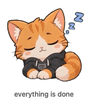
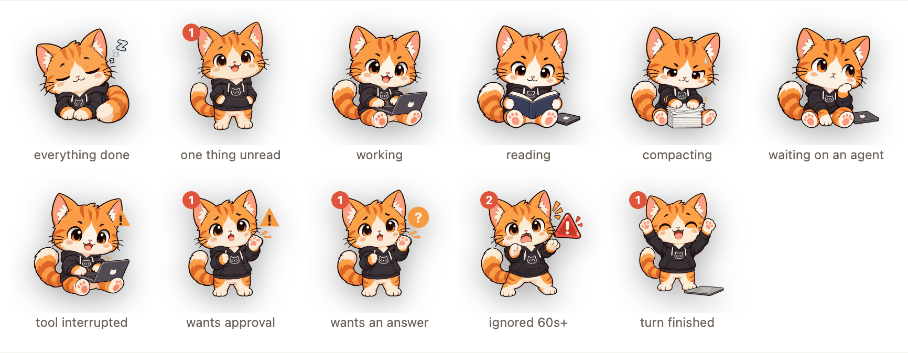
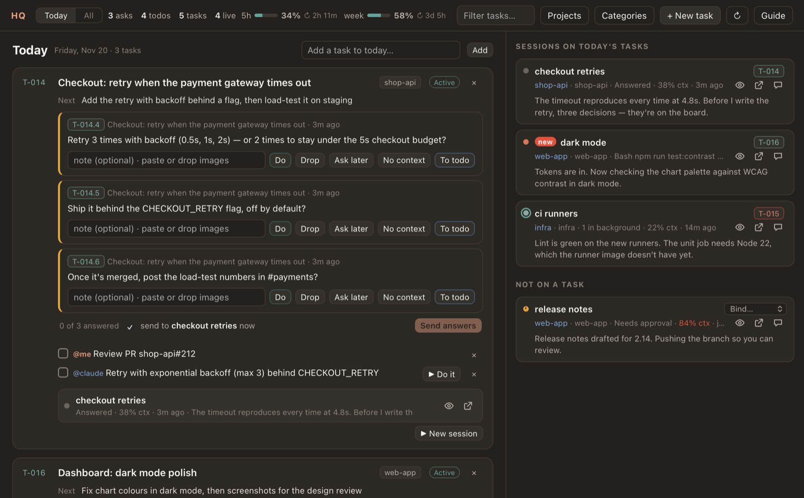
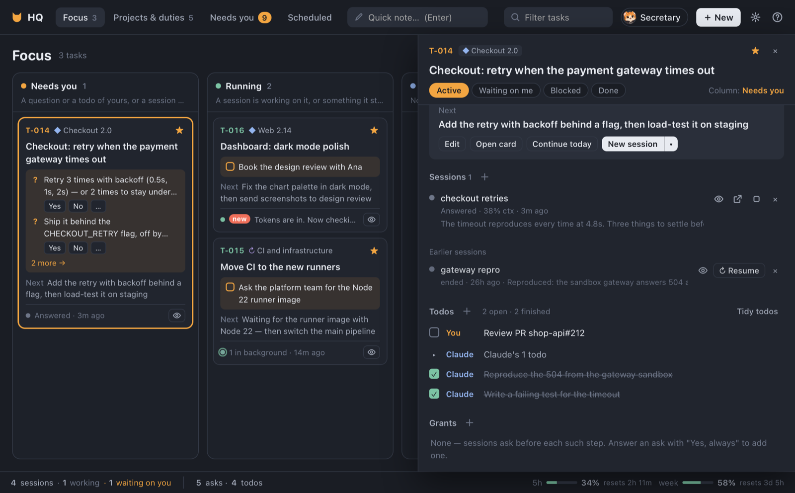
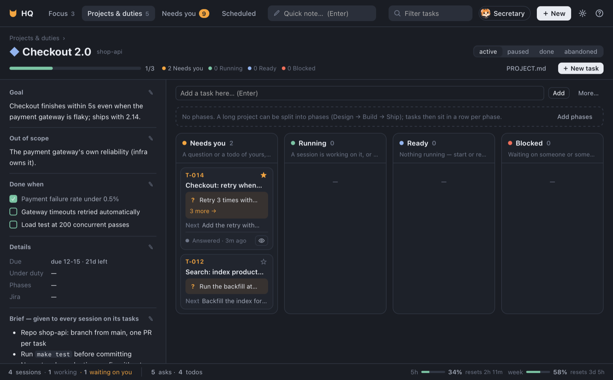
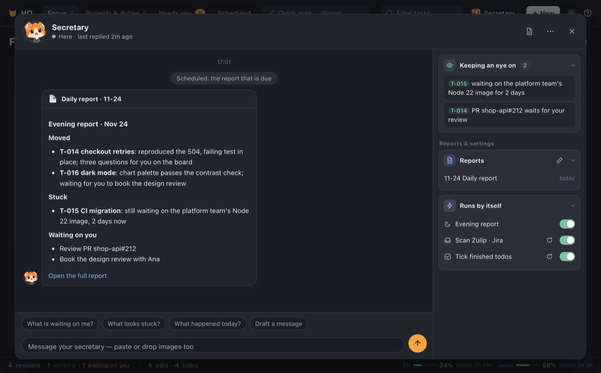
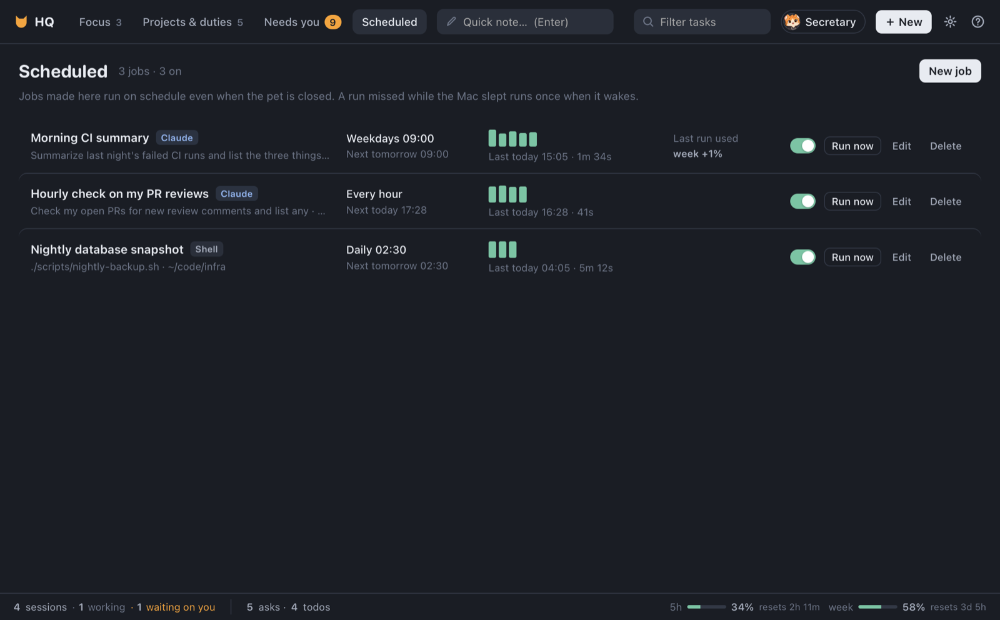

# Claude Pet

**English** · [中文](README.zh-CN.md)

[](https://github.com/ZephTu/claude-pet/actions/workflows/ci.yml)

Two things for people who run many Claude Code sessions at once on a Mac:

- **The pet** — a cat on your desktop that shows, at a glance, what every session is doing: working, finished, or waiting for you.
- **The Task Board** — a window behind the cat that keeps track of the *work*: what each session is for, what it asked you, what you still owe it — so any session can be closed and the next one picks up where it left off.



## The pet: every session at a glance

The cat's posture is the state of all your sessions together — asleep when everything has stopped, typing while something works, a raised paw when a session needs your approval or an answer, on its hind legs shouting when you have ignored it for a minute. It never makes a sound and never posts a system notification; it changes in the corner of your eye.



- **Click the cat** for the session list, grouped by what wants you first: *Needs you* (approvals, questions), *Finished* (turns you have not looked at, each with the first line of Claude's last reply), *Running*.
- **Allow or Deny** a permission prompt from the list without going back to the terminal — whichever answer comes first, there or here, counts.
- **Jump to the terminal tab** a session runs in (↗): Orca, iTerm2, Terminal, Ghostty 1.4+, and VS Code / Cursor (to the window).
- **English or 中文**: right-click → Settings → Language · 语言 switches the menus, the session list, the Task Board and its guide (or follows the system).
- **Finish bubbles** name the session that just finished and what it said; a count by the cat's ear says how many are unread.
- **Hover the cat** for your 5-hour and weekly quota; **hover a row** for its path, context use, model and the last tool call. Each row shows its context as `210k·70%`: the tokens, and their share of the auto-compact window (what `/autocompact` set, read from user settings only); the cat speaks up when a session crosses two thirds of it.
- **Mute, postpone, rename or pin** a session from its row. A muted one comes back the next time you type into it.
- It notices a session **going round in circles** (four failed tool calls in a row) and work **left running in the background** after a turn ended.

**The full tour** — every state, every button, and why each works the way it does: [docs/pet.md](docs/pet.md).

### What the pet can't see

- **Only sessions started after the install.** Hooks load when a session starts; windows already open are invisible until restarted.
- **An Esc interrupt sends no signal.** Claude Code emits no hook for it, so the pet reads Claude Code's own session status instead: such a turn shows *No recent activity* about 10 seconds later (90 seconds if that status is unavailable) rather than "finished".
- **A turn waiting on a background agent isn't "finished".** It is shown as waiting, and reported done only when the agent wakes the session again.
- **Multiple-choice questions** (`AskUserQuestion`) can't be answered from the pet — the picks are the answer, so the row takes you to the terminal.
- **Jumping and messaging depend on the terminal.** Jump: Orca, iTerm2, Terminal, Ghostty 1.4+; VS Code-family editors only to the right window, not the tab; anything else has no ↗. Sending a message from the Task Board: Orca, iTerm2 and Terminal, plus background `claude --bg` sessions between turns (the board continues them with the message). Stop works for both; Resume reuses an idle tab of the same name.
- **Quota, context and model need your statusline.** Claude Code hands them only to the statusline command; [claude-hud](https://github.com/jarrodwatts/claude-hud) or `pet-emit --statusline` has to save them ([how](docs/pet.md#optional-reading-quota-from-your-statusline)). Without that, everything else works.
- **macOS 14+ only**, and not signed by an Apple Developer ID (the installer strips the quarantine flag; Gatekeeper may still ask). Click-through is a rectangle, not the cat's outline. Animating costs about 7% of one core and 310 MB.

## The Task Board

With a dozen sessions open across several repos, the hard part stops being the work. It is remembering what each session was for, what it asked you, and whether you ever answered. The Task Board (HQ) moves that out of the conversations and into **task cards**: one per piece of work, with a status, a next step, todos and a log. A session bound to a task reads the card before it starts and writes progress back, so the card — not any one conversation — is the record.

**Double-click the cat** to open it (or right-click → **Task Board…**). Already have weeks of Claude Code sessions? [Onboarding](#onboarding-start-from-the-sessions-you-already-have) turns them into a board for you.



The board opens on **Focus**: the tasks you keep in view (it doesn't reset each day), in four columns — *Needs you*, *Running*, *Ready*, *Blocked* — each card with its open questions, your todos, its next step and its sessions. The other tabs:

- **Projects & duties** — every line of work, each with a page (below).
- **Needs you** — every unanswered question, your todos, and quick notes still to sort, with a count on its tab.
- **Scheduled** — jobs on a timetable (below).

Along the top: **Quick note** (jot a line, a link or a screenshot; a small model files it into the right task as a todo, a log line or a new card), a task filter, the **Secretary**, **+ New**, Settings, and the built-in **Guide**. The status bar shows sessions, open questions, todos and your quota.

### Questions, answered in one go

A session ends its reply with the questions it needs answered; they become **asks** on the board and stay there until you answer — nothing you skip is taken as "no". Answer them on the card, in **Needs you**, or in the task itself:

- **Yes** — go ahead, or as suggested. Write your own answer in the note if you like (several lines, screenshots welcome).
- **Yes, always** — yes, and a standing grant: the task's sessions stop asking for that kind of step.
- **No**.
- **To todo** — it is really something you will do yourself.
- **Later** — the question stays, out of sight until tomorrow, and the session is told you'll answer later.

Pick an answer for each, then send them together as one message:


The answer goes straight into the session that asked (Orca, iTerm2, Terminal, or a background session between turns), or reaches it at the start of its next turn. With several sessions on one task, only the one that asked is told.

### A task, opened



Click a card and the task opens beside the board:

- **Next** — the next step. **New session** starts Claude in the task's folder, bound to the task from its first prompt. **Continue today** carries a long-running task on in a fresh card.
- **Sessions** — the live one, with 👁 to read it, ↗ to jump to its terminal, ■ to stop it and × to unbind it. **Earlier sessions** can be picked up with **↻ Resume**.
- **Todos** — `@me` for you, `@claude` for a session. **▶ Do it** hands a Claude todo to the task's session, or starts one to do it.
- **Grants** and **Log** — what sessions may do without asking, and the decisions and findings, timestamped to the second.

### Projects and duties



A project is a line of work, not a folder:

- a **duty** — a standing responsibility, like CI or code review;
- a **goal** — it ends, maybe on a due date, and can sit under a duty.

Each one has a page: its goal, what is out of scope, the criteria that say it's done (or, for a duty, healthy), phases, and a **brief** — the rules every session on its tasks is given, like "one PR per task" or "never touch production config". Its tasks sit in the same four columns as Focus.

### Talk to a session from the board


👁 opens a session's recent conversation; reply from the box at the bottom (paste or drop images too). It arrives exactly as if you had typed it in the terminal — queued if the session is busy.

### The secretary



The **Secretary** is one Claude session for the whole board. Ask it "what is waiting on me?" or "why is T-015 stuck?". It writes an evening report on a schedule, keeps an eye on what has stalled, and can tick todos that are clearly finished. It proposes changes to the board rather than making them, and its memory (who's who, how you like reports) is plain files you can edit.

### Scheduled jobs



The **Scheduled** tab runs a Claude prompt (`claude -p`, skills and MCP tools included) or a shell command on a timetable — every N minutes, daily, weekdays, some days, or cron. It shows every job with its recent runs and the next run; each run's reply, steps and log open with a click. Jobs run under launchd, so they run with the pet closed, and a failure gets a notice from the cat. A job either starts a new session every run (keeping only the newest few) or keeps continuing one session.

**And the small things:** drafts you were typing survive a restart; removing or unbinding anything takes two clicks; the whole board, its guide included, is in English and Chinese.

HQ is optional and installed after the pet — see [hq/README.md](hq/README.md) for how it works, the `hq` CLI and the card format.

## Install

Requirements: macOS 14+, [Claude Code](https://claude.com/claude-code), and a Swift toolchain (Xcode Command Line Tools) to build from source. HQ also needs `python3` (standard library only).

```bash
./scripts/install.sh                              # the pet
hq/install.sh --root ~/claude-hq                  # optional: the Task Board; lists every change and asks first
hq/install.sh --root ~/claude-hq --no-hooks       # the board and CLI only, settings.json untouched
```

**The pet's installer edits `~/.claude/settings.json`**, appending eleven hooks and leaving yours byte for byte as they were; the file is backed up first, written atomically and verified. HQ adds three more (unless `--no-hooks`), which act only in sessions bound to a task. Hooks take effect in **newly started** sessions.

**`scripts/install.sh` installs the checkout it runs in**, so it first fetches `origin/main` (giving up after 20 seconds and using the last fetched copy) and checks that the checkout contains all of it. If not — a feature branch cut before a fix merged — it lists the missing commits and stops; run from an interactive terminal it asks first. `--force` (or `CLAUDE_PET_INSTALL_ANYWAY=1`) installs anyway. Otherwise the installed pet would quietly lose fixes that are already merged.

What it keeps: each session's current state, one record per finished turn (7 days), and **one line of each conversation** — the first line of Claude's last reply. Your prompts are never stored, and the pet makes **no network requests**. The Task Board reads live sessions' recent messages from their local transcripts to show them; nothing is sent anywhere. Details: [docs/pet.md](docs/pet.md#what-it-touches).

```bash
./scripts/uninstall.sh      # hooks, app and launch agent removed; settings.json back to what it was
hq/uninstall.sh             # HQ's hooks and commands removed; your task cards are kept
./scripts/package.sh        # a tarball with a prebuilt binary and a one-click installer, to send to someone
```

## Onboarding: start from the sessions you already have

If you have used Claude Code for a while, your work is already on disk: every session's transcript is under `~/.claude/projects`. You don't need to type the board in by hand — let Claude draft it from those transcripts.

1. **Install the pet and HQ** (above), with HQ's hooks, so bound sessions get the task rules.
2. **In any Claude Code session, run `/hq-onboard`** — or `/hq-onboard 30` to look back 30 days instead of 60. Until you have projects, the board's **Projects & duties** page shows *Start from the sessions you already have*, with a button that copies the command.
3. **Claude reads your recent sessions** and drafts the board:
   - the **lines of work** — which are duties and which are goals; one repository often holds several, and some work spans repositories;
   - a **task card for each piece of work**, with a status, the next step, open todos (yours as `@me`), related PRs and tickets, and the sessions that worked on it;
   - a **confidence** for each card, because statuses are inferred from the conversations.
4. **You review the plan.** Nothing is written until you confirm. Rename, merge, move tasks between projects, or drop anything — personal and throwaway folders are common.
5. **It creates the board**: projects, task cards, and bindings. Live sessions get their task's rules with their next message. Ended sessions are listed on their cards, so **↻ Resume** brings one back where it stopped. Each card's log says it came from onboarding and how sure Claude was; check the low-confidence ones first.

Then open the board (double-click the cat) and adjust anything on **Projects & duties**. Running `/hq-onboard` again later is safe: it skips the projects and tasks that already exist and the sessions already bound.

From then on, bind each session to the task it is for:

```text
/task T-012               in a session: bind it to T-012 and pick up from its card
/task Rerun perf baseline create a new card and bind to it
/board                    open questions, your todos and every open task, in the terminal
```

— or start sessions from a card with **New session**, already bound.

Your transcripts are read on your machine. The drafting is done by Claude in the session you ran `/hq-onboard` in, the same way any session sees what it reads.

## More

- [docs/pet.md](docs/pet.md) — the pet in full
- [hq/README.md](hq/README.md) — the Task Board: how it works, the `hq` CLI, the card format
- [promo/](promo/README.md) — the 2:59 demo film (Chinese narration) and how it is built
- [docs/development.md](docs/development.md) — tests, debugging hooks, and three things to know before changing anything

## License

MIT — see [LICENSE](LICENSE).
