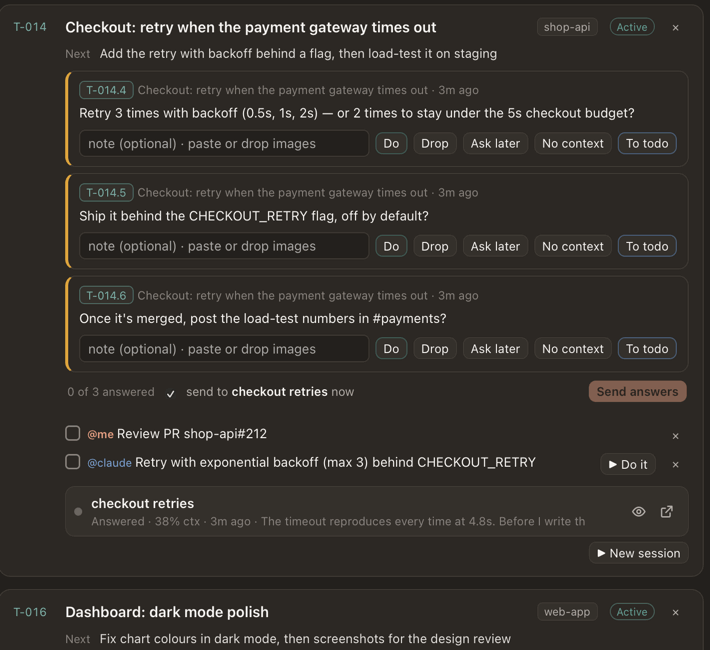
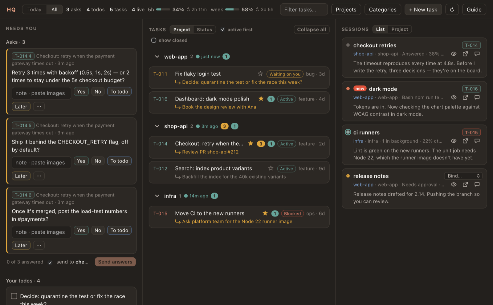
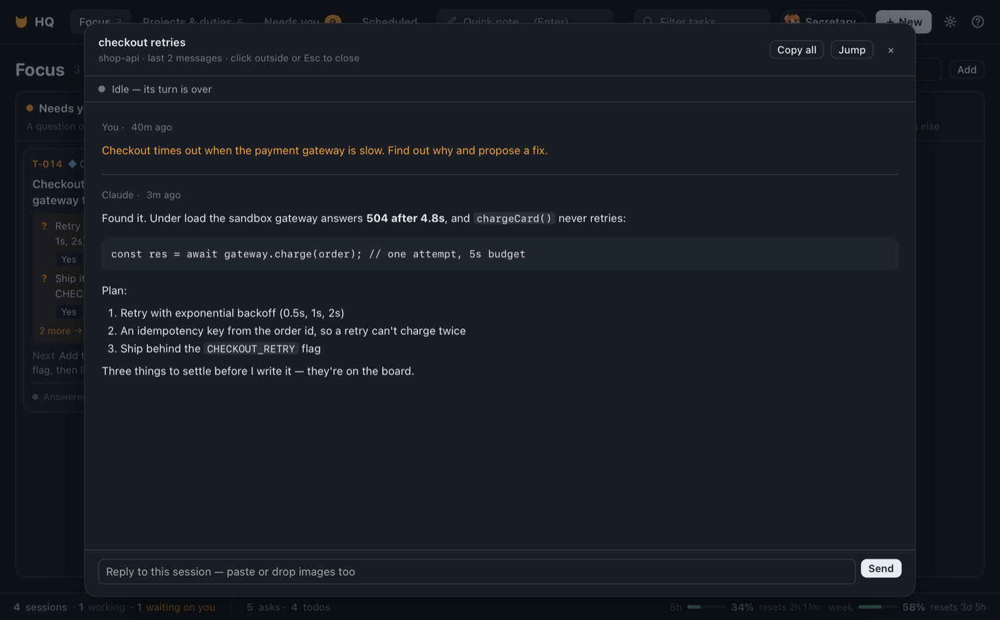

# Claude Pet

**English** · [中文](README.zh-CN.md)

[](https://github.com/ZephTu/claude-pet/actions/workflows/ci.yml)

Two things for people who run many Claude Code sessions at once on a Mac:

- **The pet** — a cat on your desktop that shows, at a glance, what every session is doing: working, finished, or waiting for you.
- **The Task Board** — a window behind the cat that keeps track of the *work*: what each session is for, what it asked you, what you still owe it — so any session can be closed and the next one picks up where it left off.


## The pet: every session at a glance

The cat's posture is the state of all your sessions together — asleep when everything has stopped, typing while something works, a raised paw when a session needs your approval or an answer, on its hind legs shouting when you have ignored it for a minute. It never makes a sound and never posts a system notification; it changes in the corner of your eye.


- **Click the cat** for the session list, grouped by what wants you first: *Needs you* (approvals, questions), *Finished* (turns you have not looked at, each with the first line of Claude's last reply), *Running*.
- **Allow or Deny** a permission prompt from the list without going back to the terminal — whichever answer comes first, there or here, counts.
- **Jump to the terminal tab** a session runs in (↗): Orca, iTerm2, Terminal, Ghostty 1.4+, and VS Code / Cursor (to the window).
- **English or 中文**: right-click → Settings → Language · 语言 switches the menus, the session list, the Task Board and its guide (or follows the system).
- **Finish bubbles** name the session that just finished and what it said; a count by the cat's ear says how many are unread.
- **Hover the cat** for your 5-hour and weekly quota; **hover a row** for its path, context use, model and the last tool call. Each row shows its context as `210k·70%`: the tokens, and their share of the auto-compact window (what `/autocompact` set, read from user settings only); the cat speaks up when a session crosses two thirds of it.
- **Mute, postpone, rename or pin** a session from its row. A muted one comes back the next time you type into it.
- It notices a session **going round in circles** (four failed tool calls in a row) and work **left running in the background** after a turn ended.

**The full tour** — every state, every button, and why each works the way it does: [docs/pet.md](docs/pet.md).

### What the pet can't see

- **Only sessions started after the install.** Hooks load when a session starts; windows already open are invisible until restarted.
- **An Esc interrupt sends no signal.** Claude Code emits no hook for it, so the pet reads Claude Code's own session status instead: such a turn shows *No recent activity* about 10 seconds later (90 seconds if that status is unavailable) rather than "finished".
- **A turn waiting on a background agent isn't "finished".** It is shown as waiting, and reported done only when the agent wakes the session again.
- **Multiple-choice questions** (`AskUserQuestion`) can't be answered from the pet — the picks are the answer, so the row takes you to the terminal.
- **Jumping and messaging depend on the terminal.** Jump: Orca, iTerm2, Terminal, Ghostty 1.4+; VS Code-family editors only to the right window, not the tab; anything else has no ↗. Sending a message from the Task Board: Orca, iTerm2 and Terminal, plus background `claude --bg` sessions between turns (the board continues them with the message). Stop works for both; Resume reuses an idle tab of the same name.
- **Quota, context and model need your statusline.** Claude Code hands them only to the statusline command; [claude-hud](https://github.com/jarrodwatts/claude-hud) or `pet-emit --statusline` has to save them ([how](docs/pet.md#optional-reading-quota-from-your-statusline)). Without that, everything else works.
- **macOS 14+ only**, and not signed by an Apple Developer ID (the installer strips the quarantine flag; Gatekeeper may still ask). Click-through is a rectangle, not the cat's outline. Animating costs about 7% of one core and 310 MB.

## The Task Board

With a dozen sessions open across several repos, the hard part stops being the work. It is remembering what each session was for, what it asked you, and whether you ever answered. The Task Board (HQ) moves that out of the conversations and into **task cards**: one per piece of work, with a status, a next step, todos and a log. A session bound to a task reads the card before it starts and writes progress back, so the card — not any one conversation — is the record.

**Double-click the cat** to open it (or right-click → **Task Board…**).


The board has three task pages. **Focus** shows only the tasks you keep in view — it doesn't reset each day — each with everything it needs from you: its open questions, your todos, and the sessions working on it. **Projects & duties** is every project and duty, each with a page of its tasks, goal, criteria and settings; **Needs you** gathers every unanswered question and your todos, with a count on its tab. A fourth tab, **Scheduled**, runs jobs on a timetable (see below). The status bar at the bottom shows counts and your quota; how sessions start lives under ⚙ Settings.

### Questions, answered in one go

A session ends its reply with the questions it needs answered; they become **asks** on the board and stay there until you answer — nothing you skip is taken as "no". Answer each with **Yes** (go ahead, or as suggested — or write your own answer in the note, several lines and screenshots welcome), **No**, **To todo** when it is really something you will do yourself, or **Later**: the question stays, out of sight until tomorrow, and the session is told you'll answer later. When a task has several, pick an answer for each and send them together as one message:



The answer goes straight into the session that asked (Orca, iTerm2, Terminal, or a background session between turns), or reaches it at the start of its next turn. With several sessions on one task, only the one that asked is told.

### Every task and every session



**All** is the whole board: tasks by project or by status on the left, every live session on the right — with the same status dots as the cat's list, its context use, and a **new** tag on a finished turn you haven't looked at.


Open a task for the rest of its card:

- **Todos** — `@me` for you, `@claude` for a session. **▶ Do it** hands a Claude todo to the task's session, or starts one to do it.
- **Sessions** — bind a live one, start a new one in the task's directory, or **↻ Resume** an earlier one where it left off.
- **Log** — decisions and findings, timestamped to the second; sessions read it.

### Talk to a session from the board



👁 opens a session's recent conversation; reply from the box at the bottom (paste or drop images too). It arrives exactly as if you had typed it in the terminal — queued if the session is busy.

### Scheduled jobs

The **Scheduled** tab runs a Claude prompt (`claude -p`, skills and MCP tools included) or a shell command on a timetable — every N minutes, daily, weekdays, some days, or cron — and shows every job with its recent runs, the next run, and each run's reply, steps and log. Jobs run under launchd, so they run with the pet closed; a failure gets a notice from the cat. Each job picks a new session every run (keeping only the newest few) or one session it keeps continuing. The tab is in English and Chinese.

**And the small things:** drafts you were typing survive a restart; removing or unbinding anything takes two clicks; the board has a built-in **Guide** in English and Chinese.

HQ is optional and installed after the pet — see [hq/README.md](hq/README.md) for how it works, the `hq` CLI and the card format.

## Install

Requirements: macOS 14+, [Claude Code](https://claude.com/claude-code), and a Swift toolchain (Xcode Command Line Tools) to build from source. HQ also needs `python3` (standard library only).

```bash
./scripts/install.sh                              # the pet
hq/install.sh --root ~/claude-hq                  # optional: the Task Board; lists every change and asks first
hq/install.sh --root ~/claude-hq --no-hooks       # the board and CLI only, settings.json untouched
```

**The pet's installer edits `~/.claude/settings.json`**, appending eleven hooks and leaving yours byte for byte as they were; the file is backed up first, written atomically and verified. HQ adds three more (unless `--no-hooks`), which act only in sessions bound to a task. Hooks take effect in **newly started** sessions.

**`scripts/install.sh` installs the checkout it runs in**, so it first fetches `origin/main` (giving up after 20 seconds and using the last fetched copy) and checks that the checkout contains all of it. If not — a feature branch cut before a fix merged — it lists the missing commits and stops; run from an interactive terminal it asks first. `--force` (or `CLAUDE_PET_INSTALL_ANYWAY=1`) installs anyway. Otherwise the installed pet would quietly lose fixes that are already merged.

What it keeps: each session's current state, one record per finished turn (7 days), and **one line of each conversation** — the first line of Claude's last reply. Your prompts are never stored, and the pet makes **no network requests**. The Task Board reads live sessions' recent messages from their local transcripts to show them; nothing is sent anywhere. Details: [docs/pet.md](docs/pet.md#what-it-touches).

```bash
./scripts/uninstall.sh      # hooks, app and launch agent removed; settings.json back to what it was
hq/uninstall.sh             # HQ's hooks and commands removed; your task cards are kept
./scripts/package.sh        # a tarball with a prebuilt binary and a one-click installer, to send to someone
```

## More

- [docs/pet.md](docs/pet.md) — the pet in full
- [hq/README.md](hq/README.md) — the Task Board: how it works, the `hq` CLI, the card format
- [docs/development.md](docs/development.md) — tests, debugging hooks, and three things to know before changing anything

## License

MIT — see [LICENSE](LICENSE).
