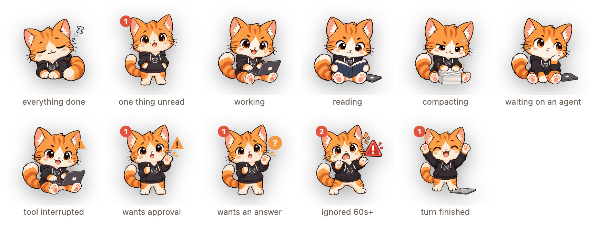
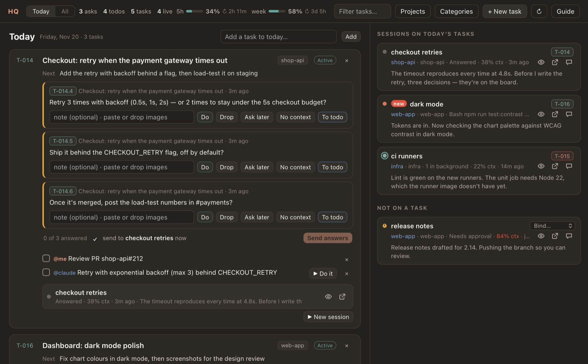
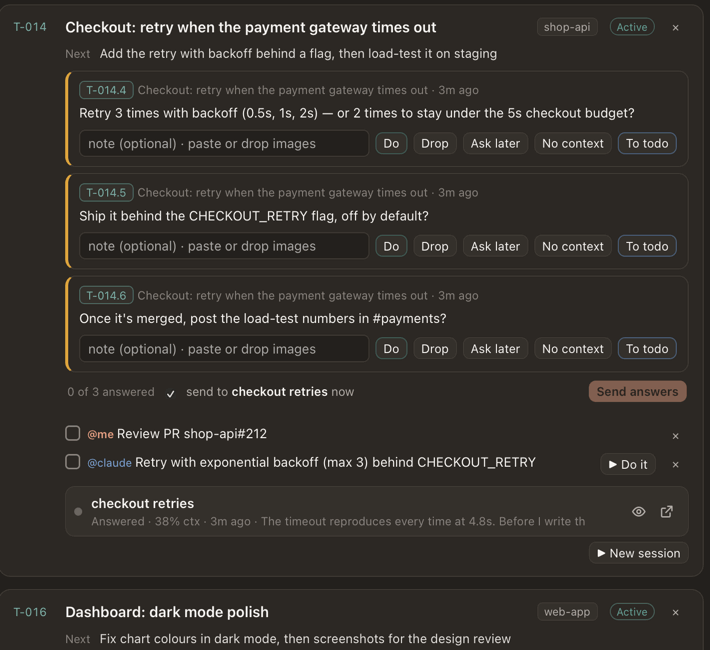
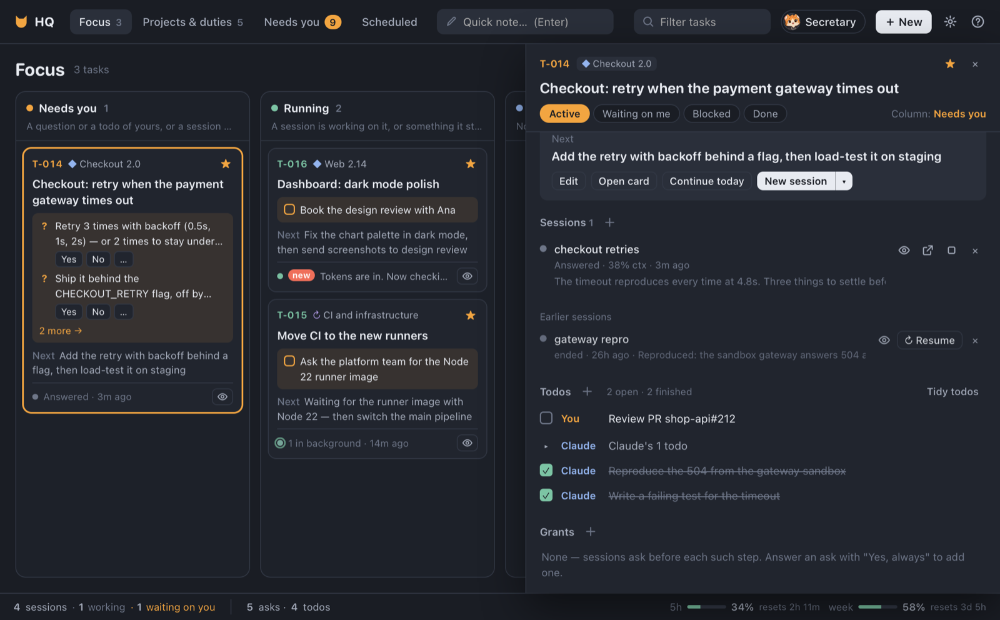
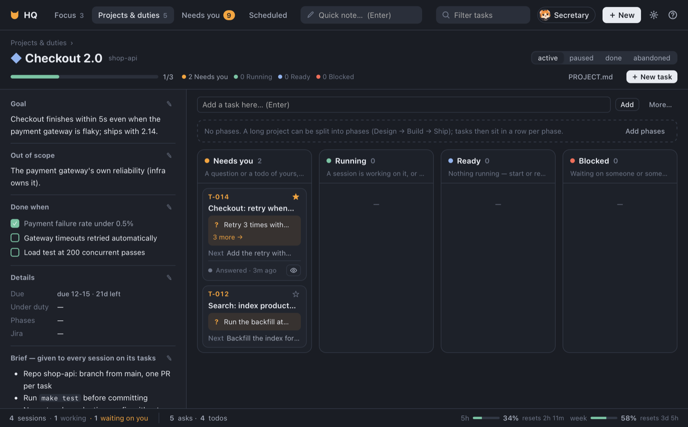
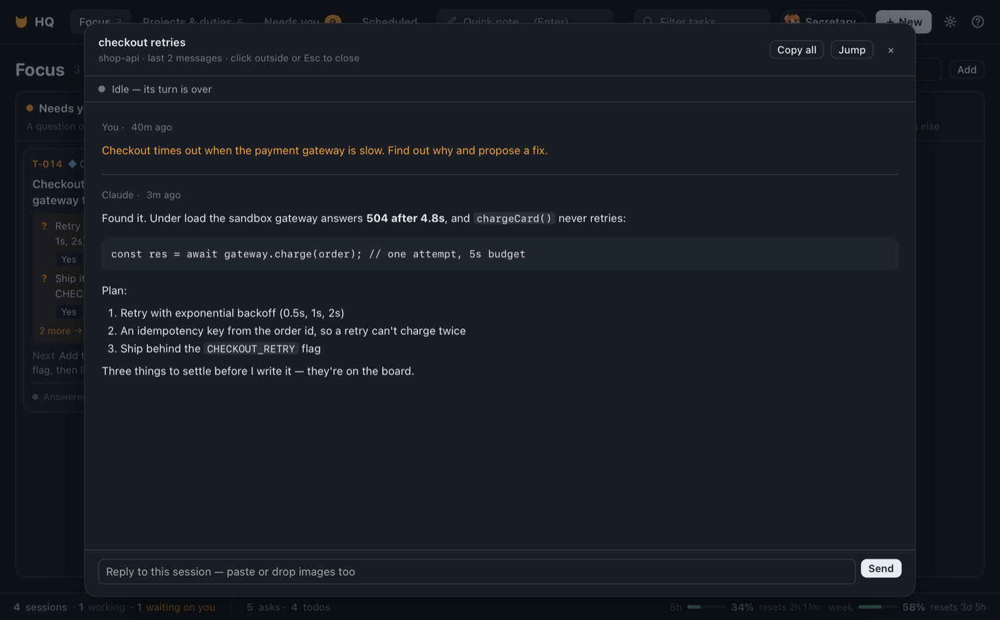
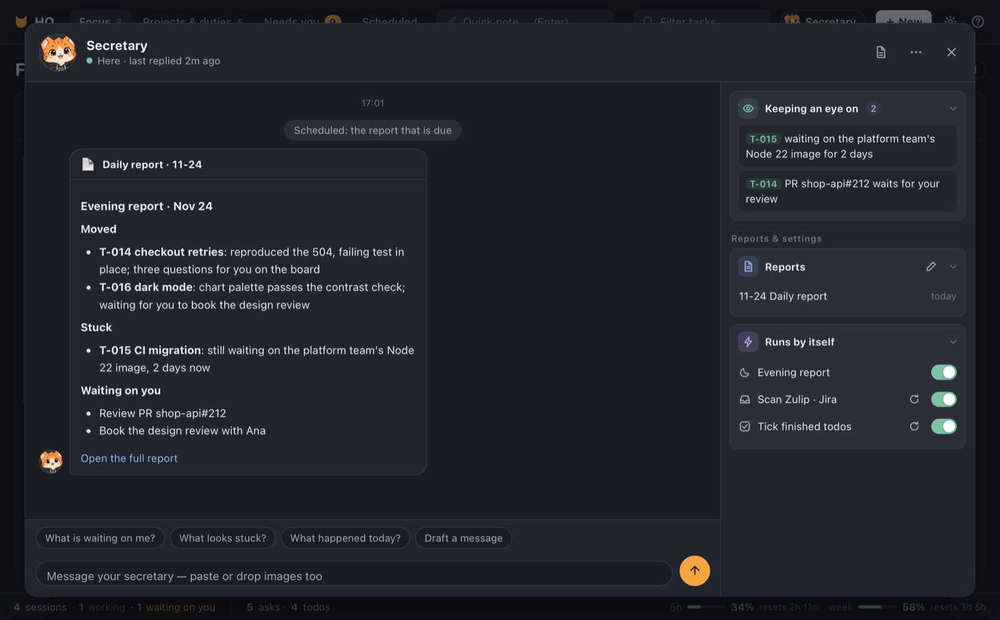
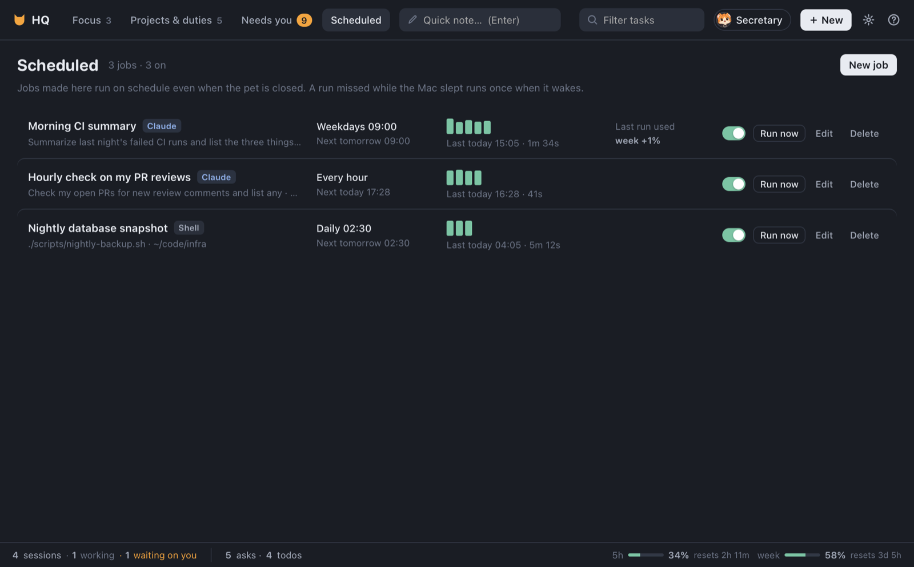

# Claude Pet

[English](README.md) · **中文**

[](https://github.com/ZephTu/claude-pet/actions/workflows/ci.yml)

给在 Mac 上（或者 Windows 上，[有哪些不同](docs/windows.zh-CN.md)）同时开着很多个 Claude Code session 的人用的两样东西：

- **桌宠**：一只坐在桌面上的猫，一眼就能看出所有 session 在干什么——在干活、干完了、还是在等你。
- **任务看板**：猫背后的一个窗口，记的是**事情**本身：每个 session 是为了什么、它问过你什么、你还欠它什么。session 随时可以关，下一个接着干。


## 桌宠：一眼看清所有 session

猫的姿势就是所有 session 合起来的状态：全都停了就睡着，有人在干活就趴着敲键盘，有 session 等你授权或回答就举起爪子，被晾了一分钟就站起来大叫。它不出声、不发系统通知，只是在你余光里变一变。



- **点猫**打开 session 列表，按谁更需要你分组：**需要你**（等授权、等回答）、**刚结束**（你还没看的那几轮，每行带 Claude 最后一句话的第一行）、**在跑**。
- 在列表里直接 **允许 / 拒绝** 授权请求，不用回终端；终端和这里谁先回答算谁的。
- 点 ↗ **跳到 session 所在的终端标签页**：支持 Orca、iTerm2、Terminal、Ghostty 1.4+，以及 VS Code / Cursor（跳到对应窗口）。
- **中文或 English**：右键 → 设置 → Language · 语言，切换菜单、session 列表、任务看板和它的使用说明（也可以跟随系统）。
- **完成气泡**说出是哪个 session 刚干完、说了什么；猫耳朵边上的数字是还没看的条数。
- **鼠标停在猫身上**看 5 小时和每周额度；**停在某一行上**看它的路径、context 用量、模型和最后一次工具调用。列表里每行的 context 显示成 `210k·70%`：token 数，以及它占自动 compact 门槛（`/autocompact` 设的值，只读用户级 settings）的比例；会话越过门槛的 2/3 时小猫会提醒一次。
- 在某一行上可以**静音、推迟、改名、置顶**。静音的 session 在你下次给它打字时自动回来。
- 能发现**原地打转**的 session（连续四次工具调用失败），以及一轮结束后**还在后台跑**的命令。

**完整说明**——每种状态、每个按钮、以及为什么这样设计：[docs/pet.zh-CN.md](docs/pet.zh-CN.md)。

### 桌宠看不到的东西

- **只认安装之后新开的 session。** hook 在 session 启动时加载，装之前就开着的窗口要重开才看得到。
- **按 Esc 打断没有任何信号。** Claude Code 打断时一个 hook 都不发，所以宠物改看 Claude Code 自己的会话状态：这种轮次大约 10 秒后显示成 *No recent activity*（读不到状态时是 90 秒），而不是"干完了"。
- **在等后台 agent 的那一轮不算"干完"。** 它显示成在等，等 agent 把 session 唤醒、真正结束时才报完成。
- **多选题提问**（`AskUserQuestion`）没法在桌宠上回答——你勾的选项就是答案，所以点这一行会跳回终端。
- **跳转和发消息取决于终端。** 跳转：Orca、iTerm2、Terminal、Ghostty 1.4+；VS Code 系编辑器只能跳到对的窗口、不一定是对的终端标签；其他终端没有 ↗。从任务看板发消息：Orca、iTerm2 和 Terminal，以及两轮之间的后台 `claude --bg` session（看板带着消息让它接着跑）。Stop 两种都支持；Resume 会复用同名的空闲标签页。
- **额度、context、模型要靠状态栏。** Claude Code 只把这些交给状态栏命令，得有 [claude-hud](https://github.com/jarrodwatts/claude-hud) 或 `pet-emit --statusline` 把它们存下来（[配置方法](docs/pet.zh-CN.md#可选从你的-statusline-读额度)）。不配的话其他功能照常。
- **支持 macOS 14 以上**，以及 Windows 10 / 11（见 [docs/windows.zh-CN.md](docs/windows.zh-CN.md)，那边看板有几项功能还没有）。Mac 版没有 Apple 开发者签名（安装脚本会去掉隔离标记，Gatekeeper 可能还会再问一次）。点击穿透按矩形算，不是按猫的轮廓。动画时大约占一个核的 7%、310 MB 内存。

## 任务看板

session 一多、分散在好几个仓库里，难的就不再是干活本身，而是记住每个 session 是干嘛的、它问过你什么、你回答了没有。任务看板（HQ）把这些从对话里搬到**任务卡**上：每件事一张卡，有状态、下一步、待办和日志。绑定到任务的 session 开工前先读卡、干完把进展写回去，所以记录在卡上，不在某一段对话里。

**双击猫**打开它（或者右键 → **任务看板…**）。已经用了几周 Claude Code、session 一大堆？[上手](#上手从已有的-session-开始)那一节让 Claude 帮你把它们整理成看板。



看板打开就是 **Focus**：你正在关注的任务（不按天清空），分成四列——**等你**、**在跑**、**待推进**、**卡住**——每张卡带着它没回答的问题、你的待办、下一步和它的 session。其他标签：

- **项目与职责**：每一条工作线，各有一页（见下文）。
- **Needs you**：所有没回答的问题、你的待办、还没归类的随手记，标签上有数量。
- **定时任务**：按时间表自动跑的任务（见下文）。

顶栏还有：**记一笔**（随手记一句话、一个链接或一张截图，小模型会把它归到对的任务上——一条待办、一行日志或一张新卡；在猫的右键菜单 → 设置里打开后，任何地方按 ⌃⌥⌘N 都能记）、任务筛选、**秘书**、**+ 新建**、设置，以及内置的使用说明（**Guide**）。底部状态栏显示 session、问题、待办的数量和你的额度。

### 一次回答多个问题

session 在回复末尾列出需要你回答的问题，它们变成看板上的**问题（ask）**，一直留着直到你回答——没回答的不会被当成"不做"。在卡片上、**Needs you** 里或者打开任务都能回答：

- **可以**：好 / 按建议来；也可以在说明里写你自己的答案（可以多行、贴截图）。
- **不要**。
- **转待办**：其实是你自己要去做的事。
- **稍后**：问题留着，隐去到第二天再出现，session 会知道你稍后再答。

逐条选好，再合成一条消息一起发：



回答会直接发进提问的那个 session（Orca、iTerm2、Terminal，或者两轮之间的后台 session），或者在它下一轮开始时送达。一个任务有好几个 session 时，只告诉提问的那一个。

### 打开一个任务



点一张卡，任务在看板旁边展开：

- **下一步**：**新 session** 在任务目录里启动 Claude，从第一句话起就绑定在这个任务上；**续到今天** 让跑了好几天的任务换一张新卡接着记。
- **Session**：在跑的那个可以 👁 查看、↗ 跳到终端、■ 停止、× 解绑；**以前的 session** 可以 **↻ Resume** 续上。
- **待办**：`@me` 是你的，`@claude` 是 session 的。**▶ 去做** 把一条 Claude 待办交给这个任务的 session，或者新开一个 session 去做。
- **日志**：决定和发现，时间精确到秒。

### 项目与职责



项目是一条工作线，不是一个文件夹：

- **职责**：长期负责的事，比如 CI、code review；
- **目标**：会结束，可以有截止日期，可以挂在某个职责下面。

每个项目有一页：目标、不管（不归它管的事）、完成标准（职责是健康标准）、阶段，以及**简报**——给这个项目下每个 session 的规矩，比如"一个任务一个 PR"、"不碰生产配置"。它的任务也按 Focus 那四列排。

### 在看板上和 session 对话



👁 打开一个 session 最近的对话，在底部的框里回复（也可以粘贴或拖入图片），效果和你在终端里亲手输入一样，session 正忙时会排队。

### 秘书



**秘书**是整块看板共用的一个 Claude session。可以问它"有什么在等我？"、"T-015 为什么卡住了？"。它按时写晚报，盯着停滞的事，也可以把明显做完的待办勾掉。它只提议改看板、不自己动手；它的记忆（谁是谁、你喜欢什么样的报告）是你可以直接改的普通文件。

### 定时任务



**定时任务** 标签页按时间表跑一段 Claude prompt（`claude -p`，可以用技能和 MCP 工具）或一条 Shell 命令——每隔 N 分钟、每天、工作日、每周几或 cron——并列出所有任务、最近几次运行和下次运行时间，每次运行的回复、过程和日志都能点开看。任务由 launchd 运行，猫关着也照跑；失败时小猫会提醒。每个任务可以选每次新开 session（只保留最近几次），或一直接着同一个 session。

**还有一些小事：** 正在输入的草稿重启后还在；删除、解绑都要点两下确认；整个看板连同使用说明都有中英文两版。

HQ 是可选的，装完桌宠后单独安装。原理、`hq` 命令行和任务卡格式见 [hq/README.md](hq/README.md)。

## 安装

需要：macOS 14+、[Claude Code](https://claude.com/claude-code)、从源码编译用的 Swift 工具链（Xcode Command Line Tools）。HQ 另外需要 `python3`（只用标准库）。

```bash
./scripts/install.sh                              # 桌宠
hq/install.sh --root ~/claude-hq                  # 可选：任务看板；先列出每一项改动，确认后才执行
hq/install.sh --root ~/claude-hq --no-hooks       # 只装看板和命令行，不碰 settings.json
```

**Windows：** 桌宠用 CI 构建的安装包里的 `install.ps1` 安装，HQ 在 Git Bash 里运行同一个 `hq/install.sh`。详细步骤见 [docs/windows.zh-CN.md](docs/windows.zh-CN.md)。

### 让 Claude 帮你安装

在任意目录打开 Claude Code，粘贴：

> 从 https://github.com/ZephTu/claude-pet 安装 Claude Pet 和它的任务看板（按 README 里"让 Claude 帮你安装"一节做），然后用我已有的 session 把看板初始化好。

**给执行安装的 Claude**——按下面的顺序做，写了"问"的地方要先问用户：

Windows 上：第 1 步检查 Windows 10 / 11、`claude.exe`、Git Bash 和 python.org 的 Python，不查 macOS 和 Swift；第 4 步按 [docs/windows.zh-CN.md](docs/windows.zh-CN.md) 用 CI 安装包安装桌宠；`hq/install.sh` 都在 Git Bash 里运行。

1. **检查**：macOS 14+（`sw_vers -productVersion`）、Swift 工具链（`swift --version`；没有的话让用户运行 `xcode-select --install`，会弹系统对话框，装好后告诉你）、`python3`、`~/.claude` 存在。缺什么就停下来说清楚。
2. **克隆** `main` 到用户愿意长期保留的目录（编译用的就是它，比如 `~/claude-pet`），只从这份代码安装——不切分支，不加 `--force`。
3. **问**任务卡放在哪（建议 `~/claude-hq`）。先不加 `--yes` 运行 `hq/install.sh --root <那个目录>`：不在终端里时，它会列出要做的所有改动（`settings.json` 里的 hook、slash 命令、目录）然后停下。把这份清单给用户看，确认后再继续。用户不想要 HQ 的 hook 就加 `--no-hooks`。
4. **安装**：先 `./scripts/install.sh` 装桌宠（编译、接上 hook——改 `settings.json` 前会先备份——并启动小猫），再 `hq/install.sh --root <目录> --yes` 装 HQ。
5. **初始化**：读 `~/.claude/commands/hq-onboard.md` 并照着做（`/hq-onboard` 命令刚装上，当前 session 可能还不认识它）。它在创建任何东西之前都会先问用户。
6. **收尾**时告诉用户：双击小猫打开看板（或右键 → Task Board…）；hook 只对从现在起新开的 session 生效，想被跟踪的 session 要重开；Claude Code 默认只保留约 30 天的对话记录（`cleanupPeriodDays`），更早的工作找不回来。

**桌宠的安装脚本会改 `~/.claude/settings.json`**：追加十一个 hook，你原有的一个字节都不动；改之前先备份，原子写入、写完校验。`settings.json` 是符号链接（比如指向 dotfiles 仓库）时，改的是它指向的文件，旁边的备份是内容的拷贝。HQ 再加三个（除非用 `--no-hooks`），只在绑定了任务的 session 里起作用。hook 只对**新开**的 session 生效。

**`scripts/install.sh` 装的是它所在的那份代码**，所以它会先抓取 `origin/main`（20 秒没响应就放弃，用上次抓到的副本），再检查这份代码是否包含它的全部提交。如果不包含（比如某个修复合并之前就切出来的功能分支），它会列出缺的提交并停下；在交互式终端里运行时会先问你。加 `--force`（或设 `CLAUDE_PET_INSTALL_ANYWAY=1`）才会照装。否则装上去的小猫会悄悄少掉已经合并的修复。

它存什么：每个 session 当前的状态、每结束一轮一条记录（保留 7 天），以及**每段对话的一行**——Claude 最后那条回复的第一行。你的提问一个字都不存，桌宠**不发任何网络请求**。任务看板为了显示最近的消息，会读本机的对话记录，不会发到任何地方。详见 [docs/pet.zh-CN.md](docs/pet.zh-CN.md#它在你机器上放了什么)。

```bash
./scripts/uninstall.sh      # 摘掉 hook、删掉 app 和开机自启；settings.json 回到装之前的样子
                            # （statusline 还在用 pet-emit 时先停下；会列出 ~/.claude/pet 里留下了什么）
hq/uninstall.sh             # 摘掉 HQ 的 hook 和命令；任务卡保留
./scripts/package.sh        # 打一个带预编译二进制和一键安装脚本的包，发给别人
```

## 上手：从已有的 session 开始

如果你已经用了一段时间 Claude Code，你的工作其实都在磁盘上：每个 session 的对话记录都在 `~/.claude/projects` 下面。不用手动一张张建卡，让 Claude 从这些记录里起草看板。

1. **装好桌宠和 HQ**（见上文），HQ 带上 hook，这样绑定的 session 才会拿到任务规则。
2. **在任意一个 Claude Code session 里运行 `/hq-onboard`**；想只看最近 30 天就用 `/hq-onboard 30`（默认 60 天）。还没有项目时，看板的 **项目与职责** 页会显示「从已有的 session 开始」，上面有一个复制这条命令的按钮。
3. **Claude 读你最近的 session**，起草看板：
   - **工作线**：哪些是职责、哪些是目标；一个仓库里常常有好几条，也有的工作跨好几个仓库；
   - **每件事一张任务卡**：状态、下一步、没做完的待办（你的记成 `@me`）、相关的 PR 和工单，以及干过这件事的 session；
   - **每张卡一个把握程度**，因为状态是从对话里推出来的。
4. **你来审。** 你确认之前什么都不写。可以改名、合并、把任务挪到别的项目，或者删掉——个人目录、临时目录很常见。
5. **它把看板建出来**：项目、任务卡和绑定。在跑的 session 下一条消息起就拿到任务规则；已经结束的 session 记在卡上，点 **↻ Resume** 就能从它停下的地方接着来。每张卡的日志里写着它来自 onboarding、Claude 有多大把握，先看把握低的。

然后打开看板（双击猫），在 **项目与职责** 里随便改。以后再跑一次 `/hq-onboard` 也没关系：已有的项目和任务、已经绑定的 session 都会跳过。

之后，每个 session 绑到它要做的任务上：

```text
/task T-012               在 session 里：绑定到 T-012，从卡片接着干
/task 重跑性能基线          新建一张卡并绑定
/board                    在终端里看没回答的问题、你的待办和所有进行中的任务
```

也可以在卡片上点 **新 session**，开出来就已经绑好了。

日常开新活就是这一圈：按 **⌃⌥⌘N**（在猫的右键菜单 → 设置里打开），写一句话，回车。猫来分拣：在对应项目下建一张新卡，出现在 Focus 里（如果属于已有的任务，就记到那张卡上）。点开卡，按 **新 session**，session 一启动就绑好了，先读卡再向你汇报。

对话记录在你本机读取；起草是你运行 `/hq-onboard` 的那个 session 里的 Claude 做的，和任何 session 读文件时一样。

## 更多

- [docs/pet.zh-CN.md](docs/pet.zh-CN.md)：桌宠的完整说明
- [docs/windows.zh-CN.md](docs/windows.zh-CN.md)：Windows 上的 Claude Pet：安装、能用的、还没有的
- [hq/README.md](hq/README.md)：任务看板的原理、`hq` 命令行、任务卡格式
- [promo/](promo/README.md)：3 分 9 秒的中文配音演示片，以及它是怎么做出来的
- [docs/development.zh-CN.md](docs/development.zh-CN.md)：测试、调试 hook、改代码之前要知道的三件事

## License

MIT，见 [LICENSE](LICENSE)。
