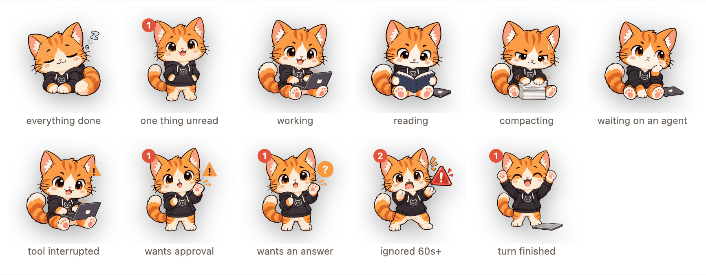
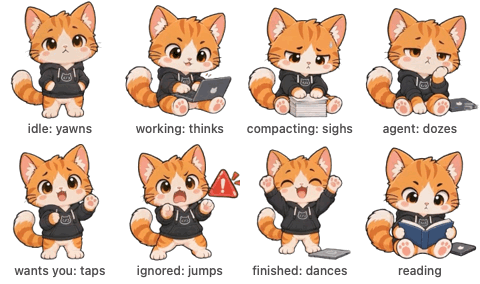

# The pet, in full

**English** · [中文](pet.zh-CN.md) · [← README](../README.md)

Everything the cat and its session list do, and why. The README has the short version.

## The picture is the signal

The cat has a drawing for nearly every state the pet knows, which is the whole
point of it — you read a posture across the room without focusing on it.



Ordered by how much it wants from you, starting from asleep:

| Meaning | What you see |
| --- | --- |
| everything is done | curled up asleep with z's drifting up |
| a turn ended and nobody has looked | awake and on its feet, the count still by its ear |
| a session is working | hunched over the laptop, typing. **Editing and running a command are the same drawing** |
| reading | a book up in both paws, nose almost in it |
| compacting its context | sorting a stack of paper. Still work — just not work you asked for |
| waiting on a background agent | chin on a paw, laptop pushed aside. Claude parked an agent and ended its turn; it will speak again by itself. **No finish notice for that turn** — nothing finished, and walking over to it would find a session that has not started |
| a tool call was interrupted | a warning triangle over a cat that carries on working. A failed call is usually not a failed task |
| a session needs your approval | a raised paw and a warning triangle, pulsing twice every five seconds so a request does not sit there unnoticed |
| a session needs an answer | the same raised paw, a question mark instead. This one wants typing, not a decision |
| ignored for 60s+ | up on its hind legs, shouting, its own red alarm beside it; the bubble names the project **and the command it is blocked on** |
| a turn just finished | both paws up, a short cheer. Deliberately short: a turn ending means Claude stopped talking, not that the work was right |

## What you can do with it

**Click it** to expand the panel. It has three groups, in the order they want your attention:

- **Needs you** — sessions blocked on an approval or a question, longest wait first
- **Just finished** — turns that ended while you were not looking, folded to one row per session, each with the first line of what Claude said last — "all 12 tests pass" and "which of these do you want?" are the difference between needing to look and not. The "done" bubble says the same line
- **Running** — everything else that is alive

Each heading carries its own count, and a lone **Running** heading is left off: one
group with nothing to tell it apart from is not a group.

A row in **Needs you** says which kind of interruption it is — **Needs approval**
against **Awaiting reply** — and sits on a tinted background (coral for an approval,
amber for a question), which deepens and turns its age bold once it has waited past the
point that turns the pet's own badge red. Its
second line is what you would be approving (`rm -rf build/`), never the hook's own
"Claude is waiting for your input": three blocked rows used to print that sentence
three times, under three first lines that already said so.

**Approve or deny without leaving your desk.** A row that is waiting on a permission carries **Allow** and **Deny**, and so does the alarm once it goes up. Claude Code shows its own prompt at the same moment and takes whichever answer comes first, so the terminal prompt is never delayed — answer there and the pet's buttons simply go away. The pet holds the `PermissionRequest` hook open while it waits (which is why that one hook is installed with a 600s timeout instead of 5s), only while the app is running, and only for the prompt it is showing: each prompt carries its own id, and a click on one that has since been replaced approves nothing. Neither button has a keyboard shortcut.

**Multiple-choice questions get no buttons.** When Claude asks with options to pick and a Submit (`AskUserQuestion`), Claude Code routes it through the same permission hook — but the picks are the answer, and an Allow from outside would hand Claude none of them. So that session shows as waiting for a reply ("2 questions to answer"), and clicking it takes you to the terminal to choose.

**Going round in circles.** A session whose last four tool calls all failed — the same test, the same build, again — looks exactly like steady work from across the room. The pet counts consecutive failures from Claude Code's own `PostToolUseFailure` events (an interrupt is not a failure, and any success resets the count), and at four the cat keeps typing under a warning glyph, the bubble names the session and what keeps failing, and the row's second line says "4 failed in a row · Bash npm test". Only the call's short target is kept, never the error text.

**While you were away.** After ten minutes with no keyboard or mouse input, the pet notes the time and your quota; the first input after that gets one line — `While you were away (42m): 3 finished · tg-server waiting 12m · quota +18%` — and nothing at all if nothing happened.

**The dot at the start of a row** says two things at once: its colour says whether the session wants you, and its shape and motion say what it is doing — so rows of one colour still read apart, including for someone who cannot tell the colours apart.

| Dot | Means |
| --- | --- |
| green, breathing | working |
| green with a small coral corner | working, but the last four tool calls all failed |
| green three-quarter arc, turning | Claude has stopped; an agent it sent off is doing the work |
| coral diamond | wants a decision |
| amber dot with a soft halo | wants an answer |
| dashed grey ring | busy on paper, but the turn was interrupted (Claude Code says idle) |
| hollow green ring | finished, not looked at yet |
| grey with a teal heartbeat | **turn over, commands still running in the background** — the row says `2 in background`, and hovering lists them (`npm run dev · 12m`), cut down by the same rule as the activity log |
| grey | idle |

The background check reads the process table every render rather than trusting the Stop payload, which is a snapshot of the moment the turn ended — a command that exits drops off within one tick. Only idle sessions are checked: while a turn runs, its own Bash call looks exactly like a background one. The cat does not wake up for background work; a dev server parked for the afternoon would keep it up all day. With the system's Reduce motion on, every animation stops and the shapes carry it alone.

A number counts both kinds of attention, by the cat's ear. It is not shown at zero.

A running row with no tool call in flight that Claude Code itself no longer calls busy
reads **No recent activity** on a hollow dot, and stops counting as busy — the pet will go
to sleep over it and says nothing about it finishing. That is almost always a turn
somebody cancelled with Esc: Claude Code emits no hook at all for an interrupt, so
the last thing written stays "busy" and nothing ever comes to take it back. The pet asks
Claude Code's own status file (`~/.claude/sessions/<pid>.json`): it flips to idle the
moment you press Esc, and the row goes quiet 10 seconds later. While that file still says
busy the row keeps saying Working however long it is silent — the model writing one large
file can go minutes without a hook. Without the file, 90 seconds of silence is the rule.
It is deliberately not called "done", which nothing here is in a position to know, and it
rights itself the moment that session does anything again.

**Drag** to move it; it remembers where you put it. Drag it near the left edge of a display and the whole layout flips — pet on the left, panel opening to its right — so the panel never runs off-screen. **Right-click the pet** for pause / keep list open / unmute all / quit; launch at login, the global shortcut, how long the finish bubbles stay and how many stack up, and the connection report sit under **Settings**. If the install is broken — hooks missing from `settings.json`, `pet-emit` gone — the menu opens with a ⚠ line naming the problem, and the cat says so once at launch. The pet follows the system's **Reduce motion** setting rather than keeping a switch of its own. **Keep List Open** pins the session list up: while it is on, neither a click on the pet nor a jump to a terminal closes it, and the panel keeps its rectangle whether or not there are sessions to list — which also means clicks land on it rather than on whatever is underneath. Turning it back off is what closes it. **Right-click a row** to name that session (an empty name goes back to the folder and tab title), pin it, or mute it.

**Click a row marked ↗** to jump straight to the terminal tab that session is running in.

- **Orca** goes through its own CLI (`orca terminal switch`) and needs no system permission at all
- **iTerm2** goes through AppleScript, so the **first jump raises a macOS Automation prompt**; deny it and jumps fail silently afterwards
- **Ghostty** goes through AppleScript too — its scripting interface arrived in **Ghostty 1.4.0**, so older versions have no ↗ — and raises the same Automation prompt on the first jump. The tab is addressed by its tty: `GHOSTTY_SURFACE_ID` is an address rather than the id the scripting interface answers to, and tty is the one field a shell's environment and that interface both carry
- **VS Code, Cursor and other VS Code forks** have no way to address one terminal from outside, so the jump asks the editor to open the session's project folder — which raises the window that already has it open. You land in the right window, not necessarily on the right terminal tab. No permission needed. The folder is the workspace Claude Code's IDE integration reports (`~/.claude/ide/*.lock`), else the enclosing git repository, else the session's directory
- Other terminals cannot be addressed — those rows have no ↗ and clicking them just closes the list

**Hover a row** for 0.45s and the bubble answers what the row has no space for: the full path and worktree, how full the context window is and on which model (with the statusline wired up), how long this turn has been going versus how long since anything happened at all, and the last tool call with its result. It used to show the session's name — which stopped being worth a hover once the first column started showing it.

**Hover the pet itself** for a second and it reports your quota as two meters — the five-hour and weekly windows side by side, each with a countdown. The bar turns amber past 60% and red past 85%, the same warning ramp everything else here uses.

**A finished row** can be clicked to jump to that session — and only then is it marked read, because a jump that did not happen must not clear the one record that it happened at all. If its session has closed there is no jump left to protect the record from, so clicking the row clears it and says why nothing opened. `clear` on the group heading marks them all. Typing your next message into that session after it finished — in its terminal or from the Task Board — also counts as having seen it, and clears the dot; so do 👁 and ↗ on the Task Board. A session woken by its own background agent does not.

**Finishes are recorded on disk, not inferred.** Claude Code's `Stop` hook writes one file per finished turn, so a turn that began and ended between two refreshes still shows up, and so does one that finished while the pet was keeping quiet. They are kept for 7 days or 500 rows, read ones discarded first; if unread ones ever have to go, the panel says how many.

**A turn that ended is not always a turn that finished.** Dispatch a background agent and Claude ends its turn immediately — the terminal says `Waiting for 1 background agent to finish`, and the pet used to put a red dot on it nine minutes before there was anything to see. `Stop` carries `background_tasks`, so a turn still holding an agent or a workflow is recorded as a pause: the session still counts as running and its row says what it is waiting for. The turn the agent eventually wakes is the one that counts as finished. A backgrounded **shell** does not hold a turn open — Claude Code's own "waiting for" count excludes it, and a dev server parked for the afternoon would otherwise silence that session for the rest of the day.

**⏱ on a blocked row** postpones it for 5, 15 or 30 minutes. The row stays visible and says how much longer — this is not muting. The delay belongs to that one approval: if the session resolves it and blocks on a different one, the new one is not postponed. Sleeping through a delay replays nothing.

**Click the × at the end of a row** to mute that session. A muted session is not in the list and cannot affect the pet's mood — it can sit blocked on a permission prompt without making the pet wave. It comes back on its own **the next time you type into it**; there is nothing to remember to undo. The panel footer says how many are muted, and the right-click menu can unmute them all at once.

When a session finishes a round of work the pet says so immediately, naming that session — so you learn it came to rest without watching for it. Each finish gets **its own small bubble for 30 seconds**, stacked above the pet with the newest nearest it, so several sessions finishing together no longer replace one another. At most three are up at once — both numbers are under **right-click → Settings → Bubble Duration** (10 / 30 / 60s) and **Bubbles at Once** (1–3); when one more arrives the oldest leaves early, and it is still in the Finished list. The stack sits above any other bubble that is showing and stays out of the way while the list is open. **Click a notice to go to that session** — the same as clicking its row in Finished: it jumps to the terminal tab (a ↗ says it can) and marks that finish read; a session whose terminal cannot be addressed opens the list instead.

**The pet makes no network requests.**

A session stays listed for as long as its process is alive, however long it sits idle. Liveness is a kernel query, not a timestamp heuristic — an open session that nobody has touched in an hour is still an open session.

**A row says what is running right now**, from the tool calls that have started and not reported back — `Bash npm test`, `Read PetLayout.swift`, or `3 tools running`. The age beside it is how long *that call* has been going, which is the number that answers "is this stuck?". Inside `busy` the figure's pose follows: reading leans at the screen, editing types, anything else sits back and waits.

**Optional: a global shortcut.** Off by default. Turn on ⌃⌥⌘J under right-click → Settings to jump to whatever has been waiting longest. Claiming a system-wide chord uninvited is taking something that was not offered, so you have to ask for it — and if another app already owns it, the menu says so instead of quietly failing.

**Right-click → Settings → Connection Status** reports what is actually wired up, in five states rather than a tick and a cross: `OK`, `Not set up`, `Not supported`, `Needs attention`, `Unknown`. The distinction matters — "you never turned this on" and "this broke" look the same to a cross and mean opposite things. Copy gives you a pasteable summary with your home directory collapsed to `~`; it describes the plumbing and never what you were working on. The check is read-only — it never edits `settings.json`.

## The cat



The cat is animated frame by frame: every pose is a loop cut out of a generated video, and after a while in one pose it slips in a small move of its own — a yawn, a scratch of the head, a page turned, a hop. Common state changes have their own transition clips; the rest are a short dissolve. `docs/seedance.md` says how the videos are made and cut. It has nine poses against the pet's eleven states — reading, compacting and waiting on a background agent each have their own, and a finished turn gets a celebration. What still collapses is the rest of busy: editing a file and waiting on a command are the same cat at the same laptop. The raised paw plus a `?` means "answer me" and plus a warning triangle means "decide this", and that glyph pulses twice every five seconds so a request does not sit unnoticed; being ignored has its own alarm painted in; an interrupted tool puts a warning over a cat that carries on working. The unread count sits by its ear.

If WebGL is unavailable or a texture will not decode, the page shows each pose's still picture instead and tells the app why.

`ClaudePet --demo` cycles the pet through everything it can show, writing nothing to disk.

## What it touches

Three places, all reversible by `./scripts/uninstall.sh`:

1. `~/Applications/ClaudePet.app` — the pet itself
2. `~/.claude/pet/` — the hook binary and the data below
3. `~/.claude/settings.json` — ten appended hooks

Inside `~/.claude/pet/`:

| Path | What it holds | Cleared |
| --- | --- | --- |
| `sessions/<id>.json` | the CURRENT state of one session: project, directory, state, running tool calls, pid, timestamps | when the session ends |
| `events/<id>~<turn>.json` | one record per finished turn | 7 days, or 500 rows |
| `activity/<id>.jsonl` | that session's last finished tool call only — tool, short target, duration, result — for the row hover; each call replaces the one before | when the session ends |
| `read.json` | which finished turns you have acknowledged | with the events they refer to |
| `usage.json` | quota numbers, only if you wired up `pet-emit --statusline` below | overwritten each time |
| `hud-usage.json` | quota numbers saved by claude-hud, only if you pointed its `externalUsageWritePath` here | overwritten by claude-hud |

Aliases, pins, mutes, snoozes and settings live in `UserDefaults`, not here.

**It keeps one line of each conversation and nothing else, and it makes no network requests of any kind.** (The optional task board, HQ, reads more — see below.) That line is the first line of Claude's last message in a finished turn, handed over by the `Stop` hook, stripped of formatting and cut to 140 characters; it is what a finished row and the "done" bubble show, and it ages out with the row after seven days. Your prompts are never stored. The activity log stores a deliberately incomplete summary of each command: the program name, then following words only up to the first one that could be carrying a value. `npm test` survives whole; `curl -H Authorization:Bearer …` becomes `curl …`. That is an allow-list by structure, not a denylist of words like "token" — a secret nobody thought to name is withheld too.

## Optional: reading quota from your statusline

Claude Code hands the rate limits only to the statusline command, so something there has to save them for the pet. Three sources are read; the freshest usable one wins, and two are never blended:

- **claude-hud 0.8+** — add `"externalUsageWritePath": "/Users/<you>/.claude/pet/hud-usage.json"` (an absolute path) under `display` in `~/.claude/plugins/claude-hud/config.json`. claude-hud then saves what its statusline input carried, at most every 30 seconds.
- **older claude-hud** — its own `.usage-cache.json`, read as is.
- **any other statusline**, on Claude Code 2.1.251 or newer — wrap it:

```jsonc
// ~/.claude/settings.json — edit this by hand
"statusLine": {
  "type": "command",
  "command": "$HOME/.claude/pet/pet-emit --statusline -- <your existing command>"
}
```

`pet-emit --statusline` passes the input through byte for byte and forwards your command's output and exit code unchanged; a parse failure costs a quota reading and nothing else.

**The installer will not do this for you, on purpose.** A statusline command is arbitrary shell you wrote — this author's is a `bash -c` with three levels of nested quoting — and rewriting one in place without ever getting it wrong is not a bet worth taking for an optional feature. It also means uninstalling the pet cannot break a statusline it never touched.

Wiring this up also gives each row a **context-window percentage**, the model's name and the session's `/rename` name — none of which reaches a hook. Hover a row to see them, along with the full path, the turn's age and the last tool call.

Two sources are never blended. Whichever reading is fresh wins; a stale reading from a better source still describes a window that may have rolled over.
